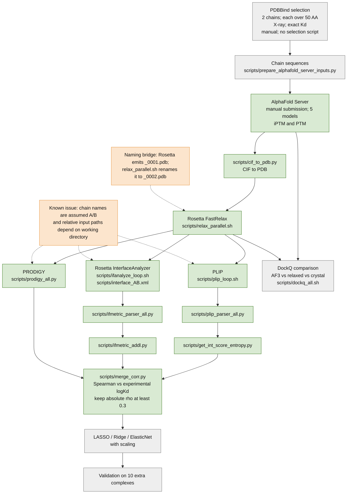

# Protein–Protein Interface Analysis Pipeline

## Objective

Build an ML model from protein-interface parameters to predict experimental Kd. The intended comparison is whether the interface-parameter model predicts Kd better than PRODIGY.
This repository is at setup stage; the workflow has not been run on real data.

## Planned pipeline

Green means the relevant script and environment are present; it does not mean the step has been run. Grey means planned or not implemented. Orange marks a known assumption or naming detail. The DockQ wrapper is present, but the comparison step remains unrun.

## Separate physicochemical-properties track

| Track | Status | Note |
|---|---|---|
| Physicochemical properties for `expressibility.xlsx` | Not started | No processing script or completed analysis is included in the current setup. |

## Environment summary

| Tool | Version | Status |
|---|---:|---|
| Python in `plip` | 3.9.13 | Set up |
| PLIP | 3.0.1 | Set up; help check passes |
| Open Babel | 3.1.1 | Set up; Python import passes |
| Python in `ppi-affinity` | 3.11.18 | Set up |
| PRODIGY | 2.2.4 | Set up; help check passes |
| DockQ | 2.1.3 | Set up; help check passes |
| Biopython | 1.88 | Set up; import passes |
| scikit-learn | 1.9.1 | Set up; import passes |
| pandas | 3.0.6 | Set up; import passes |
| scipy | 1.17.1 | Set up; import passes |
| numpy | 1.26.4 | Set up; import passes |
| Rosetta FastRelax / RosettaScripts | supplied static build | Set up; installed names start with `-help`; requested `.default` names are absent |
| Rosetta InterfaceAnalyzer | supplied static build | Set up; installed executable starts with `-help` |

See [ENVIRONMENT.md](ENVIRONMENT.md) for paths and the complete read-only check results.

## Repository layout

- `scripts/` — original analysis scripts plus local helper/wrapper scripts.
- `pdbbind/` — locally supplied PDBBind structures and indexes; excluded from Git.
- `alphafold3_server/` — input sequences, job files, chain mapping, metadata and prediction staging.
- `pilot10/` — pilot selection and run notes.
- `ALPHAFOLD_SERVER.md` — manual Server submission and download workflow.
- `ENVIRONMENT.md` — current setup checks and status.
- `CHANGES.md` — script diff against the original scripts commit and additional files.

`pdbbind/` and generated structures, scores, logs, and tables are git-ignored. PDBBind data and any needed precomputed outputs must be downloaded separately; generated outputs can be recreated locally after the AlphaFold Server results are downloaded.

## Status

### Ready

- PLIP, Open Babel, Prodigy, DockQ and the requested Python packages are available in their Conda environments.
- The supplied static Rosetta executables and repository wrappers are present. The wrappers refer to static binary names rather than the requested `.default` names.
- PDBBind and the 10-complex input files are present on this workstation.

### Not tested yet

- No end-to-end pipeline stage has been run on real data for this supervisor-facing status report.
- AlphaFold Server prediction download, pTM/iPTM capture, model conversion, feature extraction, correlation analysis and DockQ comparison remain to be performed.
- LASSO/Ridge/ElasticNet modeling, scaled model comparison and evaluation on 10 extra complexes are planned and not implemented.

### Next steps

1. Review `comp_list`, `clone_list`, `expt_kd.csv`, and `alphafold3_server/pilot10_chain_mapping.tsv`.
2. Submit the selected sequences through AlphaFold Server and download the five CIF models and confidence JSON files per complex.
3. Confirm predicted chain IDs and mappings, then begin with a controlled real-data run.
4. Implement the ML and extra-complex validation stages after feature tables are available.
