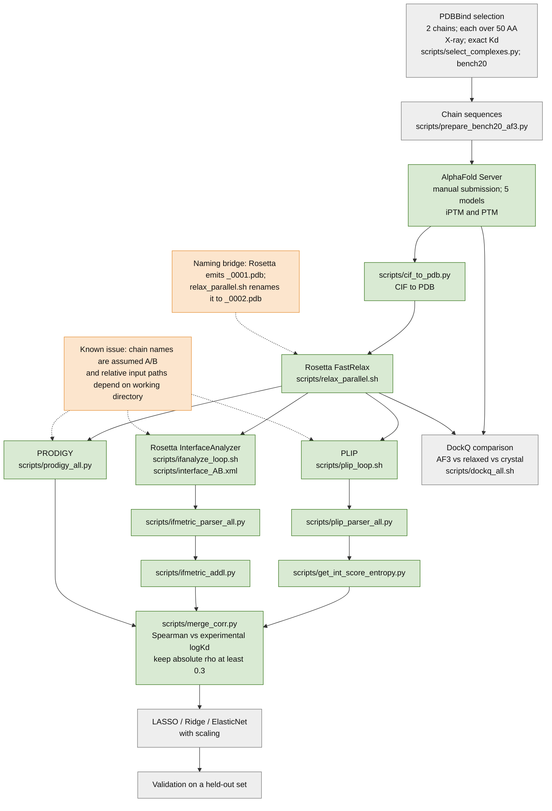
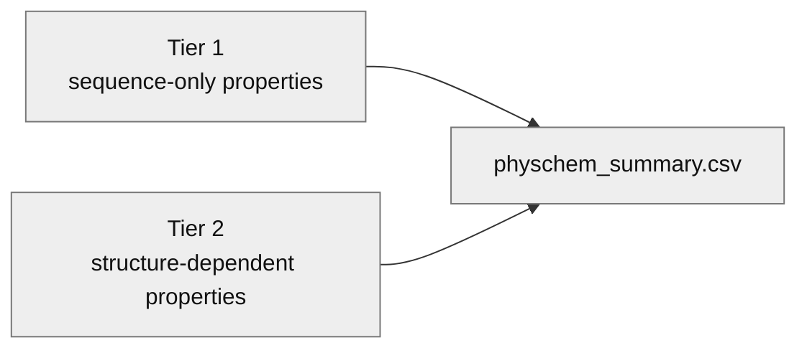

# Protein–Protein Interface Analysis Pipeline

## Objective

Build an ML model from protein-interface parameters to predict experimental Kd. The intended comparison is whether the interface-parameter model predicts Kd better than PRODIGY.
The 20-complex selection and crystal PRODIGY baseline have been run; the AF3-based feature pipeline has not yet been run.

## Planned pipeline

Green means the relevant script and environment are present; it does not mean the step has been run. Grey means planned or not implemented. Orange marks a known assumption or naming detail. The DockQ wrapper is present, but the comparison step remains unrun.

## Separate physicochemical-properties track

This track is not started. The property names and suggested tools below come from [`scripts/physiochemical.tsv`](scripts/physiochemical.tsv), which contains 19 parameter rows. The original request said 18; the supplied file lists 19.

| Property | Tier (1 = sequence only, 2 = needs structure; 1 + 2 = method-dependent) | Tool | Status |
|---|---:|---|---|
| Sequence length and molecular weight | 1 | ProtParam; `peptides.py` | Not started |
| Theoretical isoelectric point (pI) | 1 | ProtParam; `peptides.py` | Not started |
| Net charge at relevant pH | 1 | `peptides.py` | Not started |
| Amino-acid composition | 1 | ProtParam; `peptides.py` | Not started |
| GRAVY | 1 | ProtParam; `peptides.py` | Not started |
| Local hydrophobicity profile | 1 | `peptides.py` hydrophobicity profile | Not started |
| Surface hydrophobic patches | 2 | CamSol structure-corrected mode | Not started |
| Predicted intrinsic solubility | 1 | CamSol Intrinsic | Not started |
| Structure-corrected solubility | 2 | CamSol structure-corrected mode | Not started |
| Aggregation propensity | 1 + 2 | AGGRESCAN3D for structures; CamSol; sequence-based aggregation predictors | Not started |
| Instability index | 1 | ProtParam; `peptides.py` | Not started |
| Aliphatic index | 1 | ProtParam; `peptides.py` | Not started |
| Aromatic residue content (F, W, Y) | 1 | ProtParam; `peptides.py`; structure viewer for exposure context | Not started |
| Cysteine number and arrangement | 1 + 2 | ProtParam; sequence inspection; structure prediction | Not started |
| Secondary-structure percentages | 2 | `mkdssp` | Not started |
| Solvent-accessible surface area (SASA) | 2 | `mkdssp` / DSSP; FreeSASA; predicted structure | Not started |
| Structural confidence and disorder | 2 | AlphaFold confidence metrics | Not started |
| Sequence complexity and low-complexity regions | 1 | `peptides.py` sequence statistics; SEG or equivalent | Not started |
| Extinction coefficient at 280 nm | 1 | ProtParam | Not started |

CamSol Intrinsic is sequence-based and a separate tool; check availability and access before use. The official [CamSol site](https://www-cohsoftware.ch.cam.ac.uk/) provides a web service after registration. Public information does not clearly confirm a standalone command-line release for CamSol Intrinsic. The combined cysteine and aggregation rows use tier `1 + 2` because their TSV tool suggestions include both sequence-only and structure-dependent analyses.

All nodes are grey because this track has not started.

## Environment summary

| Tool | Version | Status |
|---|---:|---|
| Python in `plip` | 3.9.13 | Set up |
| PLIP | 3.0.1 | Set up; help check passes |
| Open Babel | 3.1.1 | Set up; Python import passes |
| Python in `ppi-affinity` | 3.11.18 | Set up |
| PRODIGY | 2.2.4 | Set up; help check passes |
| DockQ | 2.1.3 | Set up; help check passes |
| Biopython | 1.88 | Set up; import passes |
| scikit-learn | 1.9.1 | Set up; import passes |
| pandas | 3.0.6 | Set up; import passes |
| scipy | 1.17.1 | Set up; import passes |
| numpy | 1.26.4 | Set up; import passes |
| Rosetta FastRelax / RosettaScripts | supplied static build | Set up; installed names start with `-help`; requested `.default` names are absent |
| Rosetta InterfaceAnalyzer | supplied static build | Set up; installed executable starts with `-help` |

See [ENVIRONMENT.md](ENVIRONMENT.md) for paths and the complete read-only check results.

## Repository layout

- `scripts/` — original analysis scripts plus local helper/wrapper scripts.
- `pdbbind/` — locally supplied PDBBind structures and indexes; excluded from Git.
- `alphafold3_server/` — input sequences, job files, chain mapping, metadata and prediction staging.
- `bench20/` — 20-complex selection, baseline and run notes.
- `archive/` — superseded pilot10 run (10 complexes, never submitted) and earlier Phase A drafts; do not submit these jobs.
- `ALPHAFOLD_SERVER.md` — manual Server submission and download workflow.
- `ENVIRONMENT.md` — current setup checks and status.
- `CHANGES.md` — script diff against the original scripts commit and additional files.

`pdbbind/` and generated structures, scores, logs, and tables are git-ignored. PDBBind data and any needed precomputed outputs must be downloaded separately; generated outputs can be recreated locally after the AlphaFold Server results are downloaded.

## Status

### Ready

- PLIP, Open Babel, Prodigy, DockQ and the requested Python packages are available in their Conda environments.
- The supplied static Rosetta executables and repository wrappers are present. The wrappers refer to static binary names rather than the requested `.default` names.

### Not tested yet

- The crystal PRODIGY baseline has run on 20 real PDBBind structures; no AF3-based or relaxed-model end-to-end stage has run.
- AlphaFold Server prediction download, pTM/iPTM capture, model conversion, feature extraction, correlation analysis and DockQ comparison remain to be performed. The crystal PRODIGY rank correlations are rho = 0.0925 (Spearman) and tau = 0.0686 (Kendall).
- LASSO/Ridge/ElasticNet modeling, scaled model comparison and evaluation on 10 extra complexes are planned and not implemented.

### Next steps

1. Review `comp_list`, `clone_list`, `expt_kd.csv`, and `alphafold3_server/bench20_chain_mapping.tsv`.
2. Submit the selected sequences through AlphaFold Server and download the five CIF models and confidence JSON files per complex.
3. Confirm predicted chain IDs and mappings, then begin with a controlled real-data run.
4. Implement the ML and extra-complex validation stages after feature tables are available.
